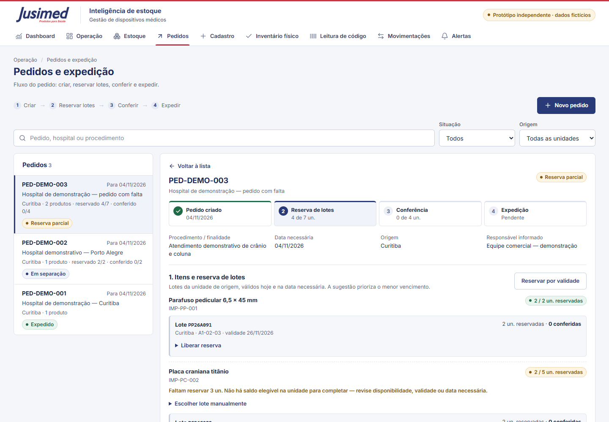

# Conceito Jusimed — controle de dispositivos médicos

Protótipo web responsivo de uma proposta para a Jusimed. Demonstra registro de movimentações e visibilidade do estoque por produto, lote, validade e localização. **É um conceito independente e não oficial; não representa um sistema implantado ou aprovado pela Jusimed.** Todos os dados são fictícios.



[Prévia de pedidos no celular](docs/pedidos-mobile.png) · [Prévia do dashboard no celular](docs/dashboard-jusimed-mobile.png)

## Executar localmente

Requisitos: Node.js 24 e pnpm. Os testes usam a execução nativa de TypeScript do Node.

```powershell
pnpm install
pnpm dev
```

Abra o endereço exibido no terminal. Para testar a leitura pela câmera em um celular, sirva o protótipo por HTTPS. Em `localhost`, o navegador também pode autorizar a câmera. A leitura manual funciona sem câmera.

## O que funciona nesta versão

- Navegação no topo com endereço por área (`#/dashboard`, `#/estoque`, `#/pedidos`…): voltar/avançar do navegador funcionam; menu recolhível no celular com Esc e retorno de foco.
- **Dashboard** empresarial baseado nos padrões do Patrimônio Ops: contexto da base, seis indicadores clicáveis, composição do saldo físico (disponível × reservas de pedido e internas × bloqueio × quarentena × vencido), pendências de pedidos com a próxima ação, atenção da gestão, tendência de movimentações e cobertura dos registros.
- Visão de operação com prioridades e movimentações recentes.
- Consulta de saldo por produto, lote e localização, com busca, filtro por situação e colunas separadas de físico, disponível e comprometido (reserva de pedido distinta da reserva interna).
- **Ficha do lote** (`#/estoque/<id>`): painel ao lado da lista (tela cheia abaixo de 1280 px) com validade, local, campo de UDI ainda não registrado, composição do saldo, situações, pedidos vinculados, movimentações, contagens e alterações da posição.
- Consulta por código do produto ou lote, digitado, lido pela câmera ou por bipador USB/Bluetooth em modo teclado no campo de leitura.
- Cadastro e edição de produtos, fabricante, fornecedor, mínimo e posições por lote/local/validade.
- Importação local de Excel (.xlsx) e CSV com prévia, validação de todas as linhas e bloqueio de duplicidades. Modelo disponível na interface.
- Saldo físico separado de reservado, bloqueado, quarentena e disponível para saída.
- Registro de entrada, saída e transferência; transferência permanece em trânsito até confirmação no destino, quando entra em quarentena.
- Bloqueio de saída acima do disponível ou de lote vencido.
- Inventário físico com consulta por etiqueta, contagem sem exibir saldo esperado, justificativa de divergência e revisão simulada antes do ajuste.
- Dashboard com situações do estoque, trânsito e contagens divergentes pendentes, além dos indicadores existentes.
- Pedidos por hospital, procedimento, data necessária e unidade de origem; reservas por lote, seleção por menor validade e tratamento de falta parcial.
- Separação com conferência de código, lote e quantidade; expedição completa com baixa de saldo e histórico por pedido. Cancelamento justificado libera as reservas.
- Indicadores clicáveis de pedidos abertos, reservas incompletas, prazo próximo com pendência e pedidos prontos para expedição.
- Alertas ilustrativos de validade e saldo mínimo.
- Exportação CSV da posição de estoque.
- Persistência local no navegador e opção de restaurar os dados fictícios.

**Não há** servidor, autenticação real, banco de dados compartilhado, sincronização contínua com planilha/ERP, controle de múltiplas empresas, validação regulatória ou auditoria imutável. O bipador deve operar como teclado; não há integração proprietária. A revisão de inventário é simulada pelo mesmo usuário. O armazenamento local pode ser apagado pelo próprio navegador e não coordena edições simultâneas entre abas ou dispositivos. Não insira dados reais ou pessoais.

## Verificação

```powershell
node --experimental-strip-types --test tests\stock.test.mjs tests\orders.test.mjs
.\node_modules\.bin\tsc.cmd --noEmit
.\node_modules\.bin\vite.cmd build
```

Os testes verificam migração, disponibilidade, limites de saldo, transferência/recebimento, revisão de contagens, duplicidades e importação atômica. `tests/fixtures/estoque-exemplo.xlsx` é um arquivo sintético usado para conferir o leitor Excel. As regras também foram exercitadas pela interface; câmera e bipadores físicos ainda precisam de validação com os equipamentos reais.

## Documentação

- [Proposta e apresentação](docs/proposta-apresentacao.md)
- [Definições dos indicadores do Dashboard](docs/analytics.md)
- [Escopo funcional e regras](docs/escopo-funcional.md)
- [Guia dos novos módulos e formato de importação](docs/operacao-v2.md)
- [Pedidos, reservas, separação e expedição](docs/pedidos-expedicao.md)
- [Descoberta e validação na empresa](docs/validacao-com-cliente.md)
- [Arquitetura e evolução para SaaS](docs/arquitetura-evolucao.md)
- [Direção visual baseada no Patrimônio Ops](docs/direcao-visual.md)
- [Aplicação da identidade Jusimed](docs/identidade-jusimed.md)
- [Como o Patrimônio Ops foi usado como referência](docs/referencia-patrimonio-ops.md)

## Estrutura

`src/data.ts` define dados fictícios e migração local. `src/domain.ts` concentra as regras de estoque e contagem. `src/importing.ts` valida CSV/Excel. `src/Catalog.tsx`, `src/StockControls.tsx` e `src/Inventory.tsx` implementam os novos módulos; `src/LotSheet.tsx` mostra a ficha do lote a partir das consultas puras de `src/lotTrace.ts`; `src/App.tsx` integra a navegação e `src/Analytics.tsx` o Dashboard. O CSS parte dos tokens de `src/styles.css`, com estilos por área em `src/analytics.css`, `src/modules.css` e `src/orders.css` (detalhes em [direção visual](docs/direcao-visual.md)).

O fluxo de pedidos fica em `src/OrderWorkspace.tsx`, com regras puras em `src/orderDomain.ts` e apresentação em `src/orders.css`. A base local usa a versão 3, com migração que preserva os saldos existentes.
